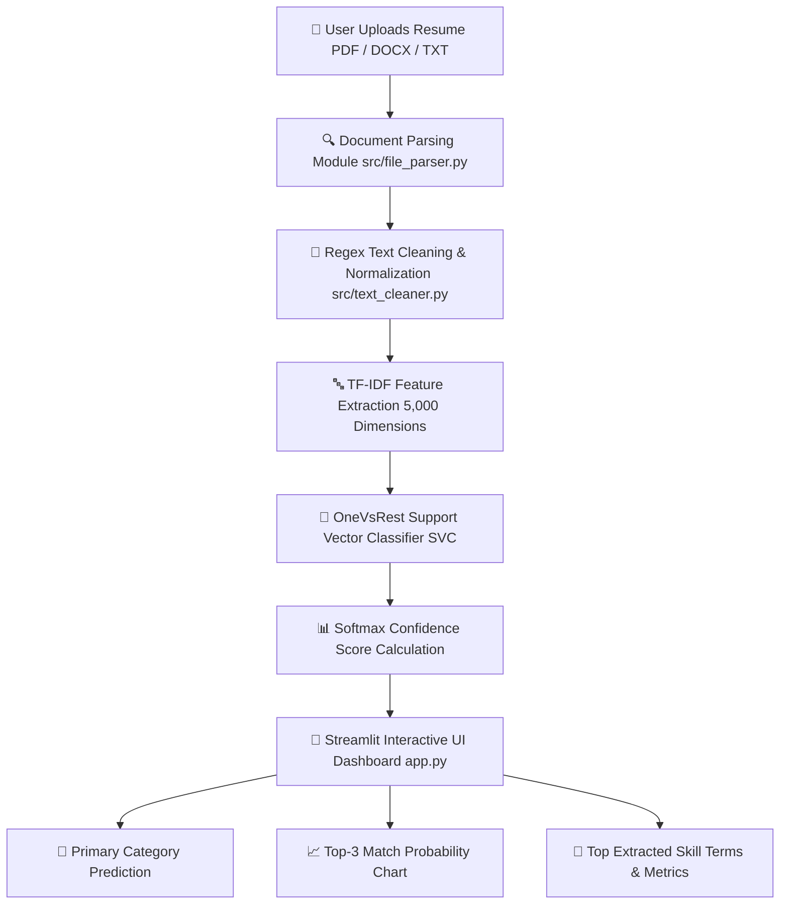

# 📄 Resume Screening & Categorization System

<div align="center">

[](https://www.python.org/)
[](https://scikit-learn.org/)
[](https://streamlit.io/)
[](https://www.docker.com/)
[](https://github.com/Abhi2006-cloud/Resume-Screening-Categorization-System/actions)
[](LICENSE)

**An AI-powered web application that automatically parses, extracts skills, and categorizes resumes into 25+ job roles with 99.76% accuracy using Natural Language Processing (NLP) and Machine Learning.**

[Features](#-key-features) • [Architecture](#-system-architecture) • [Quick Start](#-quick-start) • [Docker Setup](#-docker-deployment) • [Model Benchmarks](#-model-benchmarks)

</div>

---

## 🎯 Key Features

- **⚡ Instant Multi-Format Resume Parsing**: Upload resumes in **PDF**, **DOCX**, or **TXT** format.
- **🧠 99.76% Categorization Accuracy**: Powered by a One-vs-Rest Support Vector Machine (SVC) trained on 4,000+ sample vectors.
- **📊 Top-K Category Matches & Confidence Scores**: View top matching job categories with normalized confidence percentage scores.
- **🔑 Automated Skill Keyword Extraction**: Automatically extracts top candidate skill terms and domain frequency metrics.
- **💡 1-Click Demo Quick-Load**: Test the app immediately using built-in sample resumes without uploading your own file.
- **🎨 Interactive Streamlit UI**: Sleek, modern dashboard featuring visual probability charts and raw vs. cleaned text inspectors.
- **🐳 Containerized & CI/CD Ready**: Fully dockerized (`Dockerfile` & `docker-compose.yml`) with automated GitHub Actions testing.

---

## 🏗️ System Architecture



---

## 🚀 Quick Start

### Prerequisites
- **Python 3.8+**
- **pip** package manager

### 1. Clone & Setup Virtual Environment
```bash
# Clone the repository
git clone https://github.com/Abhi2006-cloud/Resume-Screening-Categorization-System.git
cd Resume-Screening-Categorization-System

# Create virtual environment
python3 -m venv venv
source venv/bin/activate  # On Windows: venv\Scripts\activate
```

### 2. Install Dependencies
```bash
pip install -r requirements.txt
```

### 3. Train Model Artifacts
Generate the TF-IDF vectorizer, label encoder, and SVC model:
```bash
python train_model.py
```
*Outputs artifacts into `models/` directory (`clf.pkl`, `tfidf.pkl`, `encoder.pkl`, `metrics.json`).*

### 4. Run Web Application
```bash
streamlit run app.py
```
Open your browser at `http://localhost:8501`.

---

## 🐳 Docker Deployment

Run the complete application inside a lightweight container:

### Using Docker Compose (Recommended)
```bash
docker-compose up --build
```
Access the application at `http://localhost:8501`.

### Using Docker CLI
```bash
# Build Docker image
docker build -t resume-screener .

# Run container
docker run -p 8501:8501 resume-screener
```

---

## 📂 Project Structure

```
Resume-Screening-Categorization-System/
├── app.py                      # Streamlit interactive application
├── train_model.py              # ML model training pipeline script
├── requirements.txt            # Python package dependencies
├── pytest.ini                  # Pytest configuration
├── Dockerfile                  # Container build instructions
├── docker-compose.yml          # Single-command container deployment
├── LICENSE                     # MIT License
├── README.md                   # Project documentation
│
├── src/                        # Modular source code package
│   ├── __init__.py             # Package initializer
│   ├── text_cleaner.py         # Regex text cleaning & skill extraction
│   ├── file_parser.py          # PDF, DOCX, TXT document parser
│   └── model_pipeline.py       # ResumeClassifier inference pipeline
│
├── samples/                    # Sample resume documents for instant testing
│   ├── NetworkSecurityEng_Resume.pdf
│   └── health_fitness_resume.pdf
│
├── tests/                      # Automated unit testing suite
│   ├── test_text_cleaner.py
│   ├── test_file_parser.py
│   └── test_model_pipeline.py
│
├── .github/
│   └── workflows/
│       └── ci.yml              # GitHub Actions CI automated build & test
│
└── UpdatedResumeDataSet.csv    # Training dataset (25+ job categories)
```

---

## 📊 Model Benchmarks & Metrics

The model is evaluated using 5-fold cross-validation and a stratified 80/20 train/test split:

| Metric | Score / Detail |
| :--- | :--- |
| **Model Algorithm** | Support Vector Machine (`OneVsRestClassifier(SVC)`) |
| **Feature Extraction** | TF-IDF Vectorization (`ngram_range=(1,1)`, `stop_words='english'`) |
| **Test Accuracy** | **99.76%** |
| **Training Dataset** | 4,000+ oversampled resume records |
| **Classes Evaluated** | 25 Job Roles |

---

## 🎓 Supported Job Categories

The system supports accurate categorization across 25 distinct domain roles:

| Category | Category | Category |
| :--- | :--- | :--- |
| 🤖 Data Science | 🐍 Python Developer | ☕ Java Developer |
| 🎨 Web Designing | 👔 HR | 🧪 Testing |
| 🚀 DevOps Engineer | 🛡️ Network Security Engineer | 📊 Business Analyst |
| 📈 Sales | ⚙️ Mechanical Engineer | 🏗️ Civil Engineer |
| ⚡ Electrical Engineering | 🏋️ Health and Fitness | 💼 Operations Manager |
| 📋 PMO | 🗄️ Database | 🐘 Hadoop |
| 🔄 ETL Developer | 💻 DotNet Developer | 🔗 Blockchain |
| 🤖 Automation Testing | 💼 SAP Developer | ⚖️ Advocate |
| 🎭 Arts | | |

---

## 🧪 Running Tests

Execute the comprehensive unit test suite:
```bash
pytest -v
```

---

## 🤝 Contributing

Contributions, issues, and feature requests are welcome!  
Feel free to check the [issues page](https://github.com/Abhi2006-cloud/Resume-Screening-Categorization-System/issues) or read our [CONTRIBUTING.md](CONTRIBUTING.md).

---

## 📄 License

This project is licensed under the [MIT License](LICENSE).

---

## 👤 Author

**Abhi Suryawanshi**
- GitHub: [@Abhi2006-cloud](https://github.com/Abhi2006-cloud)
- LinkedIn: [Abhi Suryawanshi](https://www.linkedin.com/in/abhi-suryawanshi-531b3a324/)

---

<div align="center">
⭐ If you found this repository useful, please consider giving it a star on GitHub!
</div>
